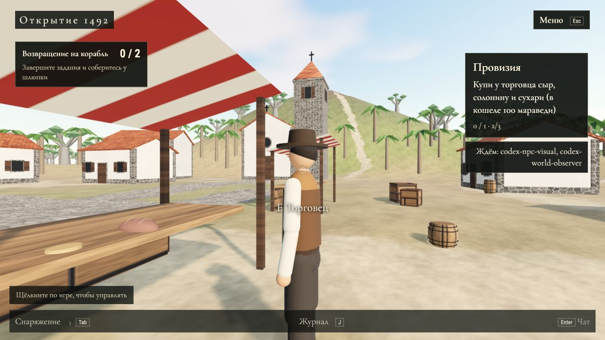
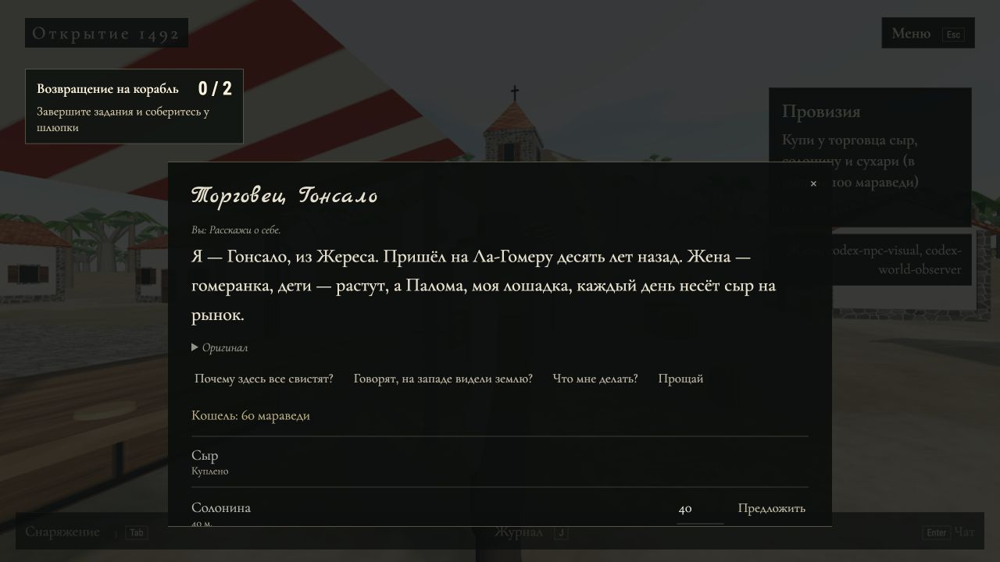

# Сейран: результат объединения и проверки, 1 ноября 2026

В `seyran` объединены маршруты/рассадка/пауза Codex (`333a643`) и работа Claude из `seyran-6cbuef` (`d1fa1c7`, `fc36594`). Основной сервер на порту 3000 не останавливался и не перезапускался. Живые проверки — на отдельном сервере 3001 с `data/codex.db`.

## Что готово

| Пункт | Результат |
|---|---|
| Вечерние NPC и ночной круг | Готово; маршруты проверены на геометрии корабля, места игроков свободны. Колумб останавливается на время разговора. |
| Свежие подсказки | Проверены 8 первых ходов реального разговора с Колумбом: набор меняется, «Прощай» последней. В браузере подтверждена смена кнопок у торговца после следующего ответа. |
| Действия Колумба | На `qwen3:4b-instruct` сработали фонари, флаг, сворачивание парусов, выдача пайка. |
| Показ и покупка товара | Торговец выкладывает товары; купленный сыр исчезает у обоих клиентов. Товар, проданный ранее, не возвращается при повторном показе. |
| `world_patch` | Добавлен недостающий путь из сокета через UI в рендер. Появляются предметы и флаг, меняются паруса, свет и туман. Данные сохраняются до загрузки мира и при смене зон. |
| Синхронизация | Два настоящих WebSocket-клиента получили одинаковые операции на все команды. Проверены полное состояние после переподключения, подбор пайка и исчезновение купленного товара. Дополнительно открыты две игровые вкладки с разными аккаунтами; ошибок в браузере нет. |
| Поступки | Бочки появляются после задания с водой; их новые места не перекрывают трап и маршрут Колумба. Выполнение задания ремонта сохраняет `pinta.repaired`, но визуальная часть ещё нужна. |
| API агентов и метрики | Проходят проверки чтения/изменения агента без перезапуска, просмотра/сброса памяти, метрик, неверного JSON и токена. Проверки идут по настоящему HTTPS с доверенным тестовым сертификатом. Валидный токен по HTTP теперь отклоняется. |
| Озвучка | Kokoro создаёт корректный WAV: mono, 24 кГц, проверена длительность 4,25 с. |

## Исправления при объединении

- Одного серверного `world_patch` было недостаточно: его не передавали в мировой модуль и не рисовали. Подключены сетевой адаптер, ожидание загрузки мира и отображение.
- Добавлены модели провизии, выбор зоны для появившихся объектов, подбор, удаление и очистка при полном сбросе. Водяные бочки имеют коллизии; дополнительные данные учитываются в бюджете кеша.
- Старые декоративные товары убраны только с прилавка торговца, чтобы после покупки не оставались их неподвижные копии.
- Бочки перенесены с трапа к свободному борту; паёк стоит на поверхности настоящего стола.
- Закрытый диалог/смена сцены больше не выполняет поздний приказ и не тратит его кулдаун.
- Приказы с отрицанием («не поднимайте флаг», «не зажигайте фонари») не запускают действий даже при ошибке модели.
- Ночные события восстанавливаются при запуске сервера посреди истории; кулдауны действий сбрасываются для нового прохождения.
- Проданный товар не появляется повторно по просьбе показать ассортимент.
- Админ-API требует HTTPS, а не только токен.

Автоматическая проверка: `npm run build` успешно; `node --test 'client/tests/*.test.js' 'server/tests/*.test.js' 'server/ai/test/*.test.js'` — 139 passed, 1 skipped, 0 failed. Пропущен старый тест внешнего сервера без `DISCOVERY_SERVER`; вместо него отдельно выполнен живой сетевой прогон, описанный выше.

## Реальная модель и скорость

Выполнены `npm run eval:ai -w server -- columbus` и `-- trader`.

Дополнительный реальный прогон: 15 ходов, включая 8 ходов разговора/подсказок, проверочные фразы и пять команд. Команды 5/5 успешны; фразы «как дела», «что мне делать», «расскажи про фонари», «хочу кушать» и отрицательный приказ не вызвали действий. Медиана ответов Колумба без синтеза голоса — около 5,6 с.

Сравнение с кодом до облачной части: 6 пар одинаковых вопросов, старый/новый код запускались по очереди на одной модели. Среднее: 7,85 → 8,60 с (+0,75 с); медиана: 7,84 → 8,05 с (+0,21 с). На отдельных парах рост достигал 1,8–2,1 с. Это небольшой замер с изменчивой длиной ответов и нагрузкой, а не гарантия задержки до +1 с для каждого запроса.

Отдельные замеры синтеза: первый запуск 11,5 с, повторный процесс 5,3 с на первой фразе и 2,9 с на следующей. В сетевом прогоне голос отключён (`TTS=0`), чтобы отдельно проверить игровую логику и модель; реальный синтез проверен отдельно.

Модель иногда неточно переводит приказы («поднимите» → «возьми») или добавляет лишние детали в разговоре (торговец упомянул дрова вне каталога). Игровые действия определяются кодом и закрытым списком, поэтому эти слова не создают новых товаров или действий. Языковую точность ещё стоит улучшить.

## Что остаётся по общему ТЗ

1. **Каркас `/admin` Тамерлана:** встроить уже готовый `mountAgentsTab` из `client/src/admin/agents.js`. Сейчас модуль и API есть, но страницы `client/admin.html` и точки монтирования ещё нет.
2. **Рендер ремонта «Пинты», Кирилл:** сервер выставляет `repaired`, клиент пока не меняет вид корабля/ремонтной площадки по этому признаку.
3. **Всплеск по просьбе «расскажи про змея»:** в общем ТЗ он указан, но в облачной части есть только автоматический туман/фонарь. Нужны действие/разрешённая сцена и визуальный/звуковой эффект; во время `night_story` обычные свободные диалоги сейчас заблокированы.
4. **Скорость и качество речи:** стабилизировать холодный синтез и задержки под несколькими одновременными разговорами; вычитать переводы и проверить точность роли/фактов. Строгий предел роста не более 1 с на каждом запросе пока не подтверждён.
5. **Вторая часть:** касик ждёт сцен, места и роли от Кирилла; сейчас этого агента нет.

Отдельно от текущего ТЗ: NPC всё ещё выполняют заданные циклы по сценам. Свободное разнообразное поведение всех персонажей, о котором был вопрос в чате, ещё не реализовано.

## Скриншоты живой проверки

После покупки сыра на прилавке остаются солонина и сухари:

Ответ настоящей модели и обновлённые подсказки:

